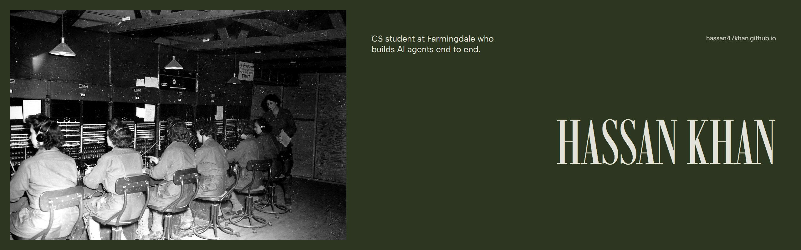

### CS student at Farmingdale State College who builds AI agents end to end, from tool calls and databases to the app on your phone.

I'm a third-year Computer Science student (3.6 GPA, President's List and Dean's List, graduating May 2028), an **AI Engineering Fellow at CodePath (AI110, Fall 2026)**, and a first-generation college student. Before software I worked on cybersecurity and digital forensics, and that still shapes how I build.

**Looking for:** software engineering, AI/ML or security internships for 2027, ideally on teams working on infrastructure, agents or applied ML.

[Website](https://hassan47khan.github.io) · [LinkedIn](https://www.linkedin.com/in/hassan-khan-03a095386/) · [hassan.c.khan@outlook.com](mailto:hassan.c.khan@outlook.com)

---

## What I've built

| Project | What it is | Built with |
| --- | --- | --- |
| **Trimly** · *on hold* | A multi-tenant SaaS I built solo. AI booking agents answer clients of independent salons and barbershops over SMS, WhatsApp, email and voice, at any hour. Claude tool-use agents with Zod-validated inputs, webhook idempotency guards, Stripe billing and real-time Socket.io streaming, packaged as a native app with Capacitor. | React 19, TypeScript, Node.js, PostgreSQL, Claude API |
| **[SubTrak](https://github.com/hassan47khan/Capstone-Project)** · *in progress* | A mobile subscription tracker with an AI-driven feature, built for Farmingdale's CSC 325 capstone. As project manager I run sprint planning and backlog priorities across the backend, database and app. | Django REST Framework, MongoDB, React Native |
| **ReAct agent from scratch** | An agent in plain JavaScript with no framework: raw tool-calling logic and a think, act, observe loop, written by hand to understand how agents actually reason. | JavaScript, LLM tool calling |
| **[Movie recommender](https://github.com/hassan47khan/Movie-Recommender)** | A REST API recommendation engine using collaborative filtering on the MovieLens dataset, with backend caching and optimized data pipelines to cut latency under load. | Python, SQL, REST |
| **OSINT investigation** | A digital forensics investigation built from open sources, with every finding traced back to where it was found. | OSINT, digital forensics |

Also here: CodePath AI110 projects ([PawPal](https://github.com/hassan47khan/ai110-module2show-pawpal-starter), [The Mood Machine](https://github.com/hassan47khan/ai110-module3tinker-themoodmachine-starter), [StudySync](https://github.com/hassan47khan/ai110-tinker-studysync-starter)), a [CI/CD pipeline](https://github.com/hassan47khan/csc325-ci-cd-pipeline), and JavaFX coursework.

---

## What I work with

**Languages:** TypeScript, JavaScript, Python, Java, SQL
**Web and backend:** React, React Native, Node.js, Django REST Framework, REST APIs, Stripe, Socket.io
**AI:** LLM agents, Claude tool use, Zod-validated tool inputs, collaborative filtering
**Data:** PostgreSQL, MongoDB, relational design
**Security:** OSINT, digital forensics, threat analysis
**Tools:** Git and GitHub, CI/CD, Linux CLI, VS Code, Claude Code

## Certificates

- CodePath: AI Engineering (AI110), Fall 2026
- AWS Educate: Cloud Computing 101, September 2026
- LinkedIn Learning: GitHub, September 2026
- Cisco Networking Academy: Data Science Essentials with Python, August 2026

## Elsewhere

Member of the Cybersecurity Club and the South Asian Student Association at Farmingdale. Bilingual in English and Urdu. Always glad to talk about AI, security, or breaking into tech as a first-gen student.
